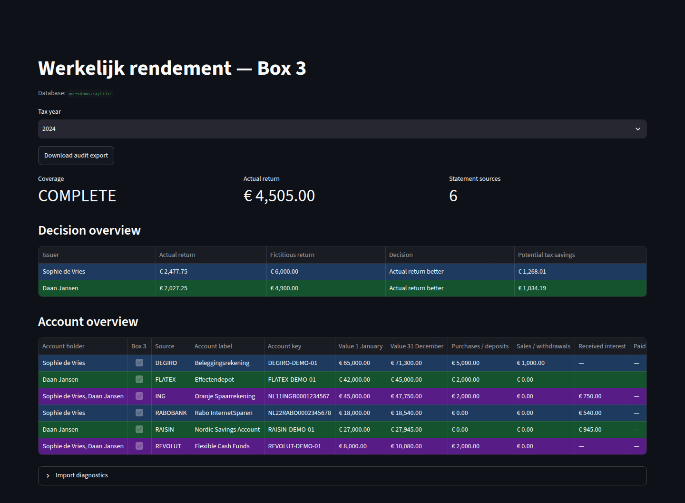

# Werkelijk Rendement

Reconstruct Dutch Box 3 actual returns from your own bank, investment, and
income-tax documents. Free, open-source, and processed entirely on your computer.
The application supports Dutch and English; these guides are written in English.

## Start here

1. Download a desktop binary from
   [GitHub Releases](https://github.com/brouns-tech/box3-werkelijk-rendement/releases)
   when available, then follow the [Windows](getting-started/windows.md) or
   [Linux](getting-started/linux.md) installation guide.
2. [Import documents](guide/importing.md) from a folder on your computer.
3. [Review taxpayers](guide/taxpayers.md), name assignments, and partner evidence.
4. [Inspect coverage, compare returns, and export the audit](guide/overview.md).

No public release has been published yet. Python and separate PDF tools are
unnecessary for desktop binaries.

## Check compatibility

Read the [supported-document matrix](reference/supported-documents.md) for exact
statement layouts. Tax comparison policies cover 2017–2025. Missing documents,
unsupported assets, or incomplete partner evidence can prevent a definitive result.
Processing every selected file does not prove your entire financial situation
is covered. Verify calculations against your original documents before using them.
The application is not affiliated with the Belastingdienst and does not submit tax returns.

## Work locally

Financial processing stays on your computer, without accounts or usage telemetry.
Read [local data and privacy](guide/local-data.md) for storage, backups, and resets.

To help extend the application, start with [Contributing](development/contributing.md).
Developers can use the [source installation and CLI guide](development/cli.md).
